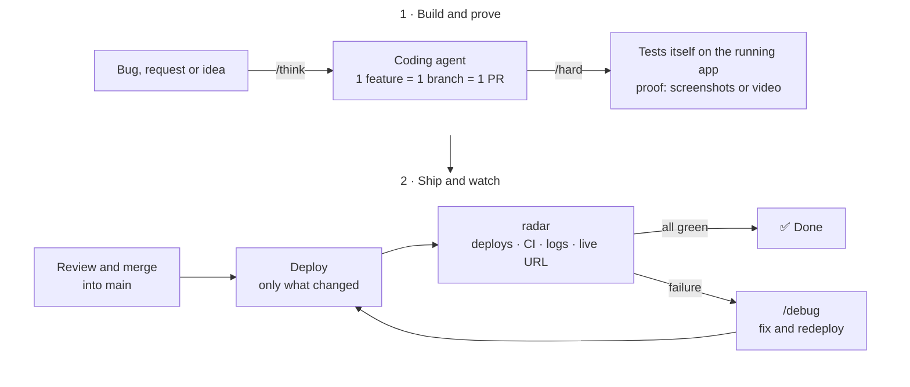

# afkit

afkit is a Cursor plugin for the product chain: from a clear coding request to verified production that keeps itself healthy. It is the product layer of a larger system (foundations, then this chain, then a company of agents that feed requests in).

## Why

AI coding agents are fast, but you can't trust them: they say "done" without checking, and you end up reviewing everything.

The chain closes that. The agent thinks before it codes, tests the change on the running app, and shows the proof. You review and merge. Only what changed deploys. Then radar checks production and fixes what breaks.

Every skill follows the same rules: **keep it simple, question everything, delete what's useless, prove it works.**

## Install

**Cursor.** Open Customize, paste `https://github.com/romeohc/afkit` in the plugin search, then install.

## Quickstart

On your app, run `/setup`. It reads the repo and writes:

1. **`radar`**, a skill made for this app (`.cursor/skills/radar/SKILL.md`). For each deployed service, it holds the commands that read the live commit, the deploy state, the logs and the public address.
2. **Path-based deploys**, so a service ships only when `main` changes and its own files changed.
3. **A Cursor automation**, `Radar - <app name>`, that runs `radar` after every merge to `main`.

If `/setup` cannot finish, it names the one thing you have to do. Run it again whenever the app changes.

Then pick a skill for each task.

## Skills

| Skill | What it does |
| --- | --- |
| `/think` | Read-only. Answers a product, growth or code question as a founder and an engineer. Also checks whether a bug is real. |
| `/hard` | Implements the change, tests it on the running app, and proves it with screenshots and a short video. |
| `/fast` | Implements the change with no verification, then opens the ports so you can test it yourself. |
| `/debug` | Reproduces the bug, proves the cause with runtime evidence, and ships the smallest fix. |
| `/clean` | Read-only. Runs several agents in parallel on a path to find what to delete or simplify, then implements only the PR you pick. |
| `/setup` | Installs the app's workflow pieces: `radar`, path-based deploys and the post-merge automation. |
| `radar` | Written by `/setup` for each app. After a merge, checks deploys, CI, logs and the live URL. Replies `✅` when all is green, fixes a clear failure, and uses `/debug` when the cause is unknown. |

## Credits

Inspired by [pstack](https://github.com/poteto/plugins/tree/main/pstack) by Lauren Tan. afkit keeps a few skills and adapts them to cloud agents.

## License

MIT. See [LICENSE](LICENSE).

---

Built by [Roméo HC](https://github.com/romeohc). Used every day to build and run [Novex](https://novex.trading).
